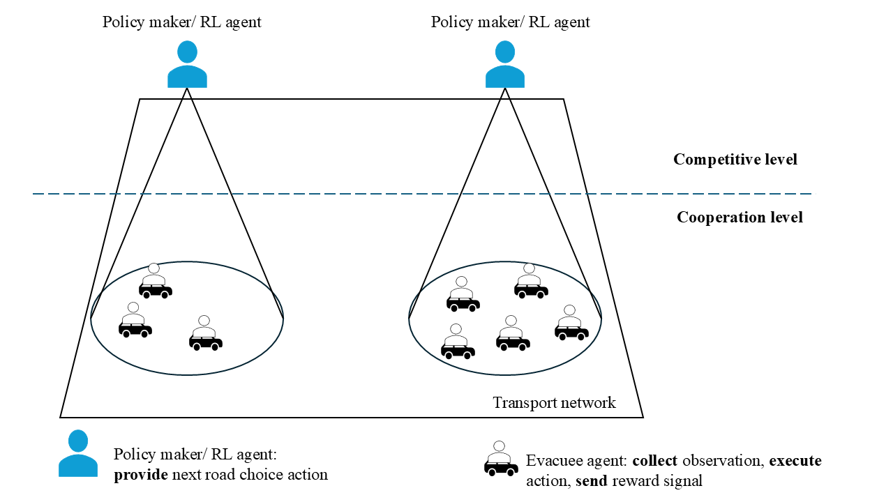

# A Multi-agent Reinforcement Learning Approach for Population Routing Optimization during Disaster Evacuation 

## Metadata

Authors: Tran Le Tuan Nguyen , Mostafa Ameli , Hassan Idoudi , Mahdi Zargayouna  
Release Date: April 2026  
Published: IEEE in 2026 IEEE International Conference on Smart Sustainable Systems for Computer and Engineering Applications (3SCEA) 

## What they did

* Using Multi Agent Reinforcement Learning with incomplete information to optimize risk factor and evacuation time during disaster
* RL optimizes distance to disaster points and evacuation time
* Creating Groups based on origin point, that share information and are guided by a single agent, based on assumption that people generally evacuate together

* Policies are trained in groups, but in active environment, each agent acts independently, but share information in that group
* Information Sharing with Transformer Model
* Simulation in SUMO
  
## Focus

* maximize Distance to disaster zones
* minimize evacuation time
* keep information limited
* Q-Learning for routing, transformers for information sharing
* States based on Current Edge, Connected Edges and vehicle density on current edge

## Findings

MARL Algorithms in combination with Transformers achieve close to optimal evacuation times (optimal computed with Dynamic A* which has complete knowledge of the network)
In comparison to other algorithms, major improvement in maximum evacuation time.

Based on their assumption and my literature review up to this point, only application of MARL with sparse information for evacuation

## What they did not do

* What happens with congestions
* No Focus on detouring, just optimal route finding
* In my understanding, static disaster zones, no dynamic, but stated in future work that they want to explore dynamic disaster
* No Focus on evacuation policies, just everybody evacuates together to different zones at the same time (e.g. staged evacuation)
* Evacuation Positions are fixed
* No realistic driver behavior (panic, non obedience...)

## Questions I have

* Why transformers for Information Sharing? Seems a bit overkill
  * This transformer gives a weighted summary for the observation of all group members
  * If attention really helps is not tested
  * (explanation with claude)
* Does this approach also consider bottlenecks in evacuation routes, e.g. when multiple groups use same intersections, have crossing paths etc.
* How can the agents act independently, if they still rely on observations from others?

[Return to the Meeting Report](../2026-11-02_Meeting-Report.md)