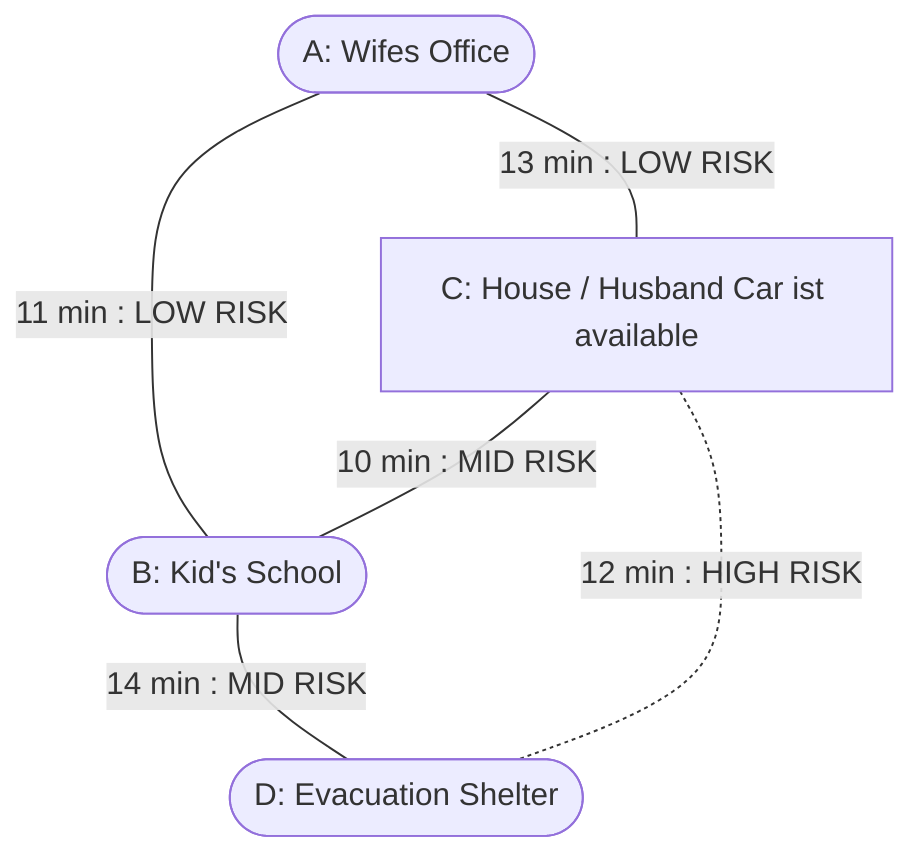

# 2026-11-09_Meeting-Report

| Item | Content |
|------|---------|
| Name | Tom Morschheuser |
| Meeting Date | 2026/11/09 |
| Previous Meeting Date | 2026/11/02 |
<!-- 
---

> **Notes on preparing this document**
>
> - **Write in proper sentences as much as possible.** Do not rely on bullet points alone; use prose where explanation is needed. If you cannot put something into clear sentences, there is a good chance you have not yet organized your own thinking well enough.
> - **Define the terms you use strictly.** Starting a discussion with ambiguous terms often leads to apparent agreement that turns out to be a misunderstanding. Always give explicit definitions for terms introduced for the first time, terms you define yourself, and terms that are used differently from prior work.
> - **When you include calculation or analysis results, upload the corresponding code separately to GitHub and provide a reference link in this document.** Without the code, the reproducibility and reliability of the results cannot be verified. Every figure, table, and numerical result must be accompanied by a link to the script that generated it.

---
-->
## 1. What I Want to Discuss Today (Most Important)

<!-- List 1–3 things you most want to discuss. These are the goals of this meeting. -->
<!-- Be explicit about what kind of decision or advice you are asking for. -->

1. Research Gap 
2. Connection to 0.5 Project
3. Research Question

## 2. Current Situation (Progress Since Last Meeting)

<!-- What have you done since the last meeting? -->
<!-- It is useful to list both what you did and what you could not do (and why). -->
### Goals from last Meeting

- Find and read papers discussing evacuation problems in general
- Find and read papers discussing state of the art simulation systems
- Discuss a link between evacuation problem and simulation
- Reason the best simulation method to solve the simulation problem

### What I did

- scanning literature for research gaps, mostly Adam J. Pel 2011 and Razan Y. Aldahlawi 2024
- Brainstorming for Research Gaps
    - Considering household chaining while evacuating
    - Dynamic destination choice is rarely explored
    - Impact of shadow evacuees and their compliance on overall evacuation results
    - Few studies incorporate human behavior findings like familiarity in routes etc into their studies.
    - modeling of compliance of evacuees is mostly not explored
    - input of behavior science into vehicle simulations
    - dynamic generators of uncertain conditions are mostly overlooked
    - Impact of information availability and situational awareness are understudied
- personal favorite of research gaps is Household Chaining
  
### What I could not do / What is delayed

- Discussing the need for simulation in this case
- Reason the best simulation / computation model for the simulation
- Beginning with formulating a precise research question. After this meeting, I want to start with that but I also want opinions in the topic I chose before going further into detail.

## 4. My Own Thoughts

<!-- For each item in Section 1, write your current thinking. -->
<!-- It does not need to be correct — the *process* of thinking is what matters. -->
<!-- Use prose where bullet points alone are insufficient. -->
**Current thought**: 

- Research Gap that is often mentioned is dynamic goal routing and household goal chaining. This is when people with cars go to get their relatives from e.g. work or school during an evacuation. This gap can be promising for simulation and comparison for what is already there, as it could be possible treated like a "shortest path problem" with dynamic goals. Further studies of literature must be conducted to verify this gap.
  
- Brainstorming for outline Research Objectives
    - Optimizing route and destination choices for households during evacuations considering car availability, destination chaining and evacuation success rate
    - investigating changes in evacuation routes based on destination chaining and evolving disaster conditions
    - Simulating destination choice updating for destination chaining using route choice models accounting en-route information acquisition during evacuations
    - Also possible connection to RL: optimizing and comparing RL to regular destination chaining algorithms in terms of accuracy and interpretability
    - Also possible connection to TD estimation, especially with en route information collection (dynamic disaster conditions...), and rerouting or dynamic goal switching.

### Rough Idea for State Model

A tentative example of how the state for this problem could be modeled is given in the following graph.
This graph is simplistic. It is intended to be implemented with microsimulation.

  
**Alternatives I considered**: 

- Impact of shadow evacuations on evacuation conditions and success
    - Simulating shadow evacuations and compliance rates with free agent routing (instead of fastest path), but haven't payed much attention to that matter

## Action Items for Next Meeting (fill in after the meeting)

<!-- Note these during or right after the meeting so they can be matched against "What I did" in the next document. -->

- Look into trip chaining for households, verify the research gap and check the environment that needs to be set
- learn the methodology used by papers in that category and how to apply them to this topic
- Define the Objective into wording. (~ end of November)
- build a playground schematic for the environment and simulation
- Check how / if TD Estimation can be integrated into this research scheme

## References

Pel, A.J., Bliemer, M.C.J. & Hoogendoorn, S.P. A review on travel behaviour modelling in dynamic traffic simulation models for evacuations. Transportation 39, 97–123 (2012). [10.1007/s11116-011-9320-6](https://doi.org/10.1007/s11116-011-9320-6)

Razan Y. Aldahlawi, Vahid Akbari, Glyn Lawson,
A systematic review of methodologies for human behavior modelling and routing optimization in large-scale evacuation planning,
International Journal of Disaster Risk Reduction,
Volume 110,
2024,
104638,
ISSN 2212-4209,
[10.1016/j.ijdrr.2024.104638](https://doi.org/10.1016/j.ijdrr.2024.104638)